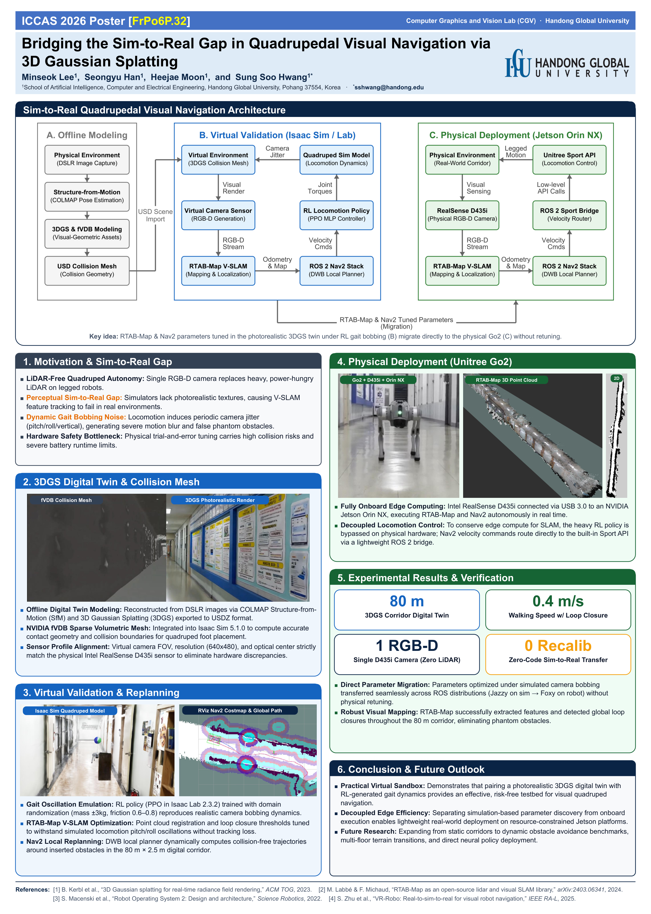

# ICCAS 2026 Poster Final Deliverables (최종 포스터 결과물)

이 폴더는 ICCAS 2026 학술대회 포스터 세션의 **최종 인쇄용 PDF 및 편집용 PPTX 파일**을 모아둔 전용 폴더입니다.

- **논문 제목**: *Bridging the Sim-to-Real Gap in Quadrupedal Visual Navigation via 3D Gaussian Splatting*
- **저자**: Minseok Lee, Seongyu Han, Heejae Moon, and Sung Soo Hwang*
- **소속**: School of Artificial Intelligence, Computer and Electrical Engineering, Handong Global University
- **세션 코드**: `FrPo6P.32`
- **규격**: A0 Portrait (`84.10 cm × 118.00 cm`)

---

## 📁 파일 목록 (Files)

| 파일명 | 형식 | 설명 |
| :--- | :--- | :--- |
| **`ICCAS_자율주행팀포스터.pdf`** | PDF | **학교 이미지스테이션 출력실 제출용 PDF** (벡터 텍스트 및 고해상도 이미지 포함, 100% 실측 출력) |
| **`ICCAS2026_Poster_Quadruped.pdf`** | PDF | 영문 파일명 동일 인쇄용 PDF |
| **`ICCAS2026_Poster_Quadruped.pptx`** | PPTX | **마스터 편집용 파워포인트 원본** (직접 편집 가능) |
| **`poster_preview.png`** | PNG | 최종 포스터 전체 고해상도 미리보기 이미지 |

---

## 🎨 주요 반영 사항 (Latest Updates)
1. **Acknowledgement 제거**: 교수님 피드백 반영 완료.
2. **세로 레이아웃 재배치**: 여백 균형 최적화(상단 1.45 cm, 하단 1.65 cm, 섹션 간격 1.00 cm 균일 리듬).
3. **가독성 최적화**: 2단 카드 본문 폰트 25pt 통일 및 카드 높이 확장.
4. **고해상도 실효 DPI**: Hero 아키텍처 다이어그램 266 DPI, 주요 실험 이미지 130~200 DPI로 A0 대형 인쇄에 최적화.

---

## 🖼️ 최종 포스터 미리보기 (Preview)

