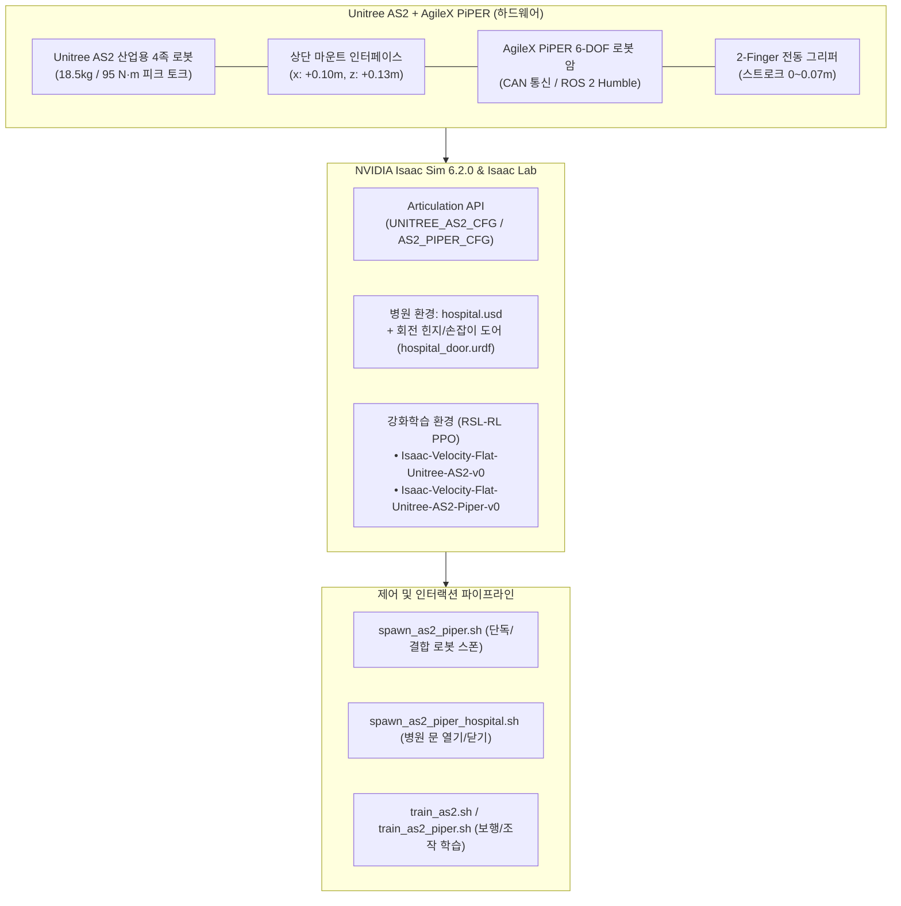

# Unitree AS2 + AgileX PiPER Mobile Manipulator
## NVIDIA Isaac Sim 6.2.0 & Isaac Lab Simulation Framework
### Computer Graphics and Vision Lab (CGV)

[](https://docs.isaacsim.omniverse.nvidia.com/latest/index.html)
[](https://isaac-sim.github.io/IsaacLab)
[](https://docs.ros.org/en/humble/)
[](https://github.com/CGV-HGU/isaac-go2-ros2/tree/As2)
[-orange.svg)](https://www.unitree.com)
[](https://github.com/agilexrobotics)

---

## 1. 개요 (Overview)

본 저장소의 **`As2`** 브랜치는 CGV 연구실(Computer Graphics and Vision Lab)에 새로 도입된 **Unitree AS2 산업용 4족 보행 로봇**과 **AgileX PiPER 6자유도 경량 로봇 암**(공급사: (주)로아스 ROAS)을 결합한 모바일 매니퓰레이터(Mobile Manipulator)를 최신 **NVIDIA Isaac Sim 6.2.0** 및 **Isaac Lab** 환경에서 구동·학습하기 위한 연구 플랫폼입니다.

기존 레거시 Go2 관련 파일 및 불필요한 설정들을 전수 정리(Cleaned)하여, 브랜치 전체가 오직 **Unitree AS2**와 **AgileX PiPER**의 결합 기구학, 강화학습(RL), 그리고 **병원(Hospital) 환경 내 실시간 개폐 도어(Articulated Door) 조작 시뮬레이션**에 집중되어 있습니다.



---

## 2. 주요 기능 및 지원 환경 (Key Features)

### 1) 병원 환경(`hospital.usd`) 및 상호작용 도어(Articulated Door) 시뮬레이션
* **Hospital USD 에셋 연동**: Isaac Sim Nucleus의 `Environments/Hospital/hospital.usd` 고해상도 병원 층별 레이아웃을 로드합니다.
* **열고 닫히는 인터랙티브 도어**:
  - 기구학 모델: [`source/isaaclab_assets/data/props/door/hospital_door.urdf`](file:///sdcard/Documents/github/isaac-go2-ros2/source/isaaclab_assets/data/props/door/hospital_door.urdf) 및 `.usda`
  - 회전 힌지(`door_hinge`, 0.0 ~ 1.6 rad)와 스프링 복원식 레버 손잡이(`door_handle_joint`) 구현.
  - 유압식 도어 클로저 댐핑(PhysX Damping)이 적용되어 로봇 팔이 손잡이를 누르고 밀어 열면 부드럽게 닫히는 실감형 물리 시뮬레이션을 제공합니다.
* **원클릭 병원 시뮬레이션 실행**:
  ```bash
  ./spawn_as2_piper_hospital.sh
  ```

### 2) Unitree AS2 산업용 규격 반영
* 보행 로봇 베이스를 Go2(15kg, 23.5 N·m)에서 **Unitree AS2(18.5kg, 95 N·m 피크 토크)** 규격으로 완전히 재설정하여 무거운 PiPER 암 탑재 시에도 안정적인 페이로드와 강력한 보행 복원력을 발휘합니다.
* 커스텀 AS2 로컬 USD가 있는 경우 환경변수 `UNITREE_AS2_USD_PATH`로 즉시 오버라이딩 가능합니다.

### 3) AgileX PiPER 6-DOF 로봇 암 통합
* 6자유도 매니퓰레이터 및 2핑거 전동 그리퍼 공식 메시/USD 서브모듈([`robot_arms/piper/piper_isaac_sim`](file:///sdcard/Documents/github/isaac-go2-ros2/robot_arms/piper/piper_isaac_sim)) 포함.
* 통합 기구학 정의: [`robot_arms/piper/descriptions/as2_piper.urdf`](file:///sdcard/Documents/github/isaac-go2-ros2/robot_arms/piper/descriptions/as2_piper.urdf).

### 4) Isaac Lab 강화학습(RL) Task 등록
* `Isaac-Velocity-Flat-Unitree-AS2-v0`: AS2 단독 평지 속도 추종 보행 학습
* `Isaac-Velocity-Rough-Unitree-AS2-v0`: AS2 단독 험지 보행 학습
* `Isaac-Velocity-Flat-Unitree-AS2-Piper-v0`: AS2 + PiPER 복합 모바일 매니퓰레이션 학습

---

## 3. 빠른 시작 가이드 (Quick Start)

### Step 1: 저장소 클론 및 `As2` 브랜치 설정
```bash
# 연구실 서버 또는 워크스테이션에서 클론
git clone https://github.com/CGV-HGU/isaac-go2-ros2.git -b As2
cd isaac-go2-ros2

# 서브모듈(AgileX PiPER 3D 에셋/USD) 동기화 (최초 1회 필수)
git submodule update --init --recursive
```

### Step 2: 시뮬레이션 데모 실행

#### A. 병원 환경에서 로봇 암으로 문 열기/닫기 시뮬레이션
```bash
# AS2 + PiPER 병원 환경 및 인터랙티브 개폐 도어 시뮬레이션
./spawn_as2_piper_hospital.sh
```

#### B. AS2 + PiPER 모바일 매니퓰레이터 기본 인터랙티브 스폰
```bash
# 기본 복합 로봇 스폰 및 실시간 암 모션 데모
./spawn_as2_piper.sh

# 단독 로봇만 스폰하고 싶을 때
./spawn_as2_piper.sh --standalone_as2   # AS2 사족보행 로봇만 스폰
./spawn_as2_piper.sh --standalone_arm   # PiPER 로봇 암만 스폰
```

### Step 3: 강화학습(RL) 실행
```bash
# (1) Unitree AS2 단독 보행 강화학습 (RSL-RL PPO)
./train_as2.sh --num_envs 2048

# (2) Unitree AS2 + AgileX PiPER 복합 강화학습
./train_as2_piper.sh --num_envs 2048
```

---

## 4. 디렉터리 구조 (Repository Structure)

```text
isaac-go2-ros2/
├── docs/
│   └── isaac_sim_6_2_as2_piper_guide.md      # 연구실 서버 및 Isaac Sim 6.2.0 종합 기술 매뉴얼
├── robot_arms/
│   └── piper/
│       ├── README.md                          # ROAS PiPER 로봇 암 상세 가이드 & SDK 매뉴얼
│       ├── descriptions/
│       │   ├── as2_piper.urdf                 # AS2 + PiPER 통합 URDF 기구학
│       │   └── as2_piper.urdf.xacro           # 통합 Xacro 매크로
│       └── piper_isaac_sim/                   # AgileX 공식 Isaac Sim USD/Mesh 서브모듈
├── scripts/
│   ├── demos/
│   │   ├── spawn_as2_piper.py                 # AS2 + PiPER 기본 인터랙티브 스폰 스크립트
│   │   └── spawn_as2_piper_hospital.py        # 병원 환경 + 도어 개폐 모바일 매니퓰레이션 데모
│   ├── reinforcement_learning/
│   │   └── rsl_rl/play.py                     # ROS 2 카메라 브리지(/as2_camera) 연동 스크립트
│   └── tools/
│       └── compose_as2_piper_usd.py           # 단일 as2_piper.usd 파일 자동 빌드 도구
├── source/
│   ├── isaaclab_assets/
│   │   ├── data/props/door/
│   │   │   ├── hospital_door.urdf             # 회전 힌지 및 손잡이가 있는 인터랙티브 도어 URDF
│   │   │   └── hospital_door.usda             # Isaac Sim 네이티브 PhysX Articulation 도어
│   │   └── isaaclab_assets/robots/
│   │       ├── as2_piper.py                   # AS2_PIPER_CFG, UNITREE_AS2_CFG, PIPER_ARM_CFG 정의
│   │       └── hospital_door.py               # HOSPITAL_DOOR_CFG Articulation 설정
│   └── isaaclab_tasks/manager_based/locomotion/velocity/config/
│       ├── as2/                               # AS2 단독 보행 학습 Task 정의
│       └── as2_piper/                         # AS2 + PiPER 복합 조작 학습 Task 정의
├── spawn_as2_piper.sh                         # AS2 + PiPER 원클릭 기본 실행 스크립트
├── spawn_as2_piper_hospital.sh                # 병원 도어 개폐 시뮬레이션 원클릭 실행 스크립트
├── train_as2.sh                               # AS2 단독 RL 학습 스크립트
└── train_as2_piper.sh                         # AS2 + PiPER 복합 RL 학습 스크립트
```

---

## 5. 하드웨어 및 기술지원 자료 (Hardware References)

* **베이스 로봇**: Unitree AS2 Industrial Quadruped ([Unitree Robotics](https://www.unitree.com))
* **로봇 암 공급사**: (주)로아스 (ROAS) 기술지원팀
* **로봇 암 제조사 리소스**:
  - [AgileX Robotics 공식 GitHub](https://github.com/agilexrobotics)
  - [AgileX PiPER Python SDK](https://github.com/agilexrobotics/piper_sdk)
  - [AgileX PiPER ROS 2 Humble 패키지](https://github.com/agilexrobotics/Piper_ros)
* **소프트웨어**:
  - NVIDIA Isaac Sim 6.2.0 & Isaac Lab v2.3+
  - ROS 2 Humble Hawksbill

---

## 6. 연구실 정보 (Laboratory)

* **연구실**: **Computer Graphics and Vision Lab (CGV)**
* **소속**: 한동대학교 (Handong Global University)
* **연구 주제**: 모바일 매니퓰레이션(Mobile Manipulation), Sim-to-Real 사족보행 로봇 제어, 강화학습 및 로봇 비전
