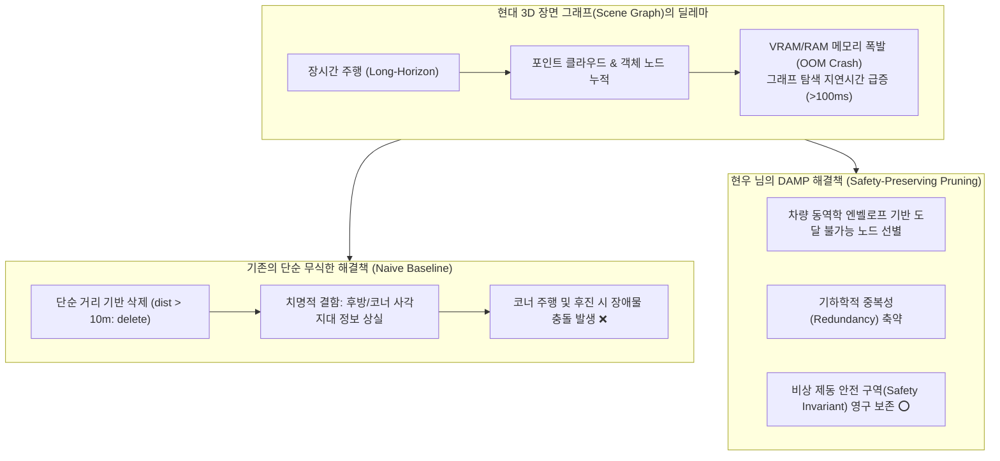
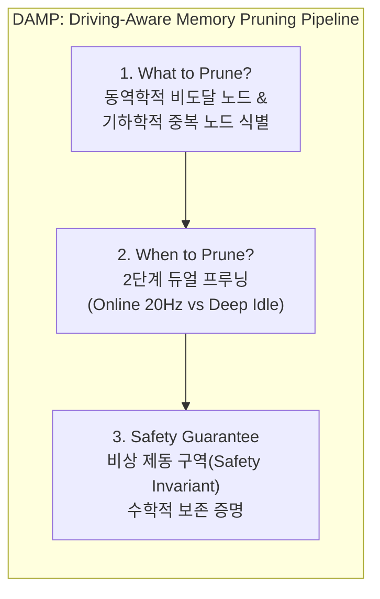
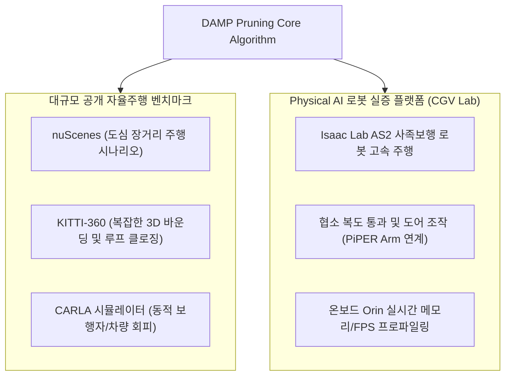
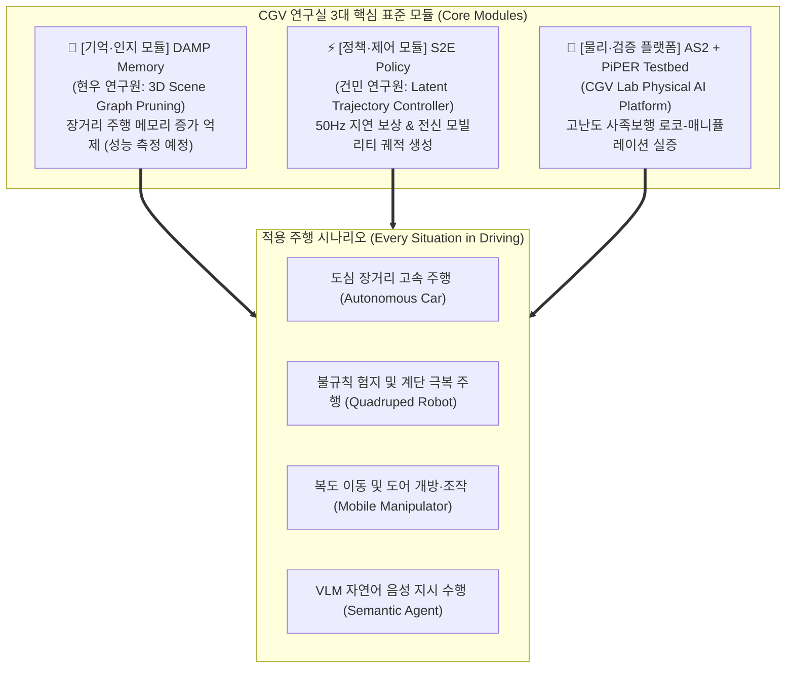

# DAMP: Driving-Aware Memory Pruning Master Plan
**컴퓨터 그래픽스 및 비전 연구실 (Computer Graphics and Vision Lab, CGV)**  
*주 저자 / 핵심 연구: 현우 (Hyunwoo) | 타겟 저널: IEEE Robotics and Automation Letters (RA-L) 2026*

> [!IMPORTANT]
> **핵심 연구 정체성 (Core Identity: 100% Pruning-Centric)**
> 본 마스터 플랜은 복잡하고 산만한 다중 모듈 나열을 전면 배제하고, **현우 님의 핵심 연구인 '3D Scene Graph 메모리 가지치기(DAMP: Driving-Aware Memory Pruning)'**를 절대적인 단일 주인공으로 확립합니다.
> 
> Unitree AS2 사족보행 로봇과 VLM, Isaac Sim 환경은 알고리즘의 주인이 아닌, **"제안한 프루닝 기법이 실제 고속·장시간 주행에서도 충돌 없이 메모리를 80% 이상 절감함을 입증하는 고난도 실증 벤치마크(Evaluation Testbed)"**로 엄격히 포지셔닝합니다.

---

## 1. 연구의 핵심 문제 정의: 자율주행의 '메모리 폭발'과 '위험한 삭제'



* **메모리 포화의 딜레마**: 자율주행 차량이나 사족보행 로봇이 30분 이상 주행하면 3D Scene Graph의 노드 수가 수십만 개로 증가하여 온보드 컴퓨터(NVIDIA Orin 등)가 메모리 부족(OOM)으로 다운됩니다.
* **기존 연구(MIT DAAAM 및 단순 거리 컷)의 치명적 한계**:  
  단순히 반경 10m 밖의 노드를 삭제하면 메모리는 줄어들지만, **급커브를 돌거나 회피 기동 시 필요한 랜드마크와 장애물까지 지워버려 충돌(Collision)**을 유발합니다.
* **현우 님의 핵심 질문 (Research Question)**:  
  **"메모리는 80% 이상 획기적으로 줄이면서도, 주행 안전성(Collision-Free)은 100% 수학적으로 보장할 수 있는 가지치기(Pruning) 기준은 무엇인가?"**

---

## 2. 현우 님의 DAMP Pruning 알고리즘 3대 핵심 기여 (Contributions)



### 기여 1: 무엇을 지울 것인가? (What to Prune)
1. **동역학적 비도달 노드 (Kinematically Unreachable Nodes)**:
   * 차량(또는 사족로봇)의 최고 속도 $v_{\max}$, 최대 조향각 $\delta_{\max}$, 가속도 한계를 바탕으로 계산된 **도달 가능 영역(Forward Reachable Set, $\mathcal{R}_{\text{kin}}$)** 외부에 있는 노드를 1차 후보로 지정합니다.
2. **기하학적/시맨틱 중복성 축약 (Geometric & Semantic Redundancy)**:
   * 평평한 도로 바닥이나 거대한 일자 벽면처럼 동일한 시맨틱 평면 위에 존재하는 수백 개의 불필요한 메쉬 노드를 **대표 바운딩 박스(Bounding Primitive) 1개로 병합(Merge) 및 압축**합니다.

### 기여 2: 언제 지울 것인가? (When to Prune - Dual-Stage Strategy)
생체 신경계가 주행 중 최소 인지만 하고 휴식(수면) 중에 기억을 고착화·정리하듯, 컴퓨터 연산 부하를 최소화하는 **2단계 듀얼 프루닝 파이프라인**을 제안합니다.

* **Stage 1: Fast Online Pruning (주행 중, 20Hz)**:
  * CPU/GPU 오버헤드를 $2\text{ ms}$ 이내로 제한하는 경량 격자(Grid) 기반 외곽 바운딩 노드 즉각 제거.
* **Stage 2: Deep Idle Consolidation (신호 대기 / 정차 / 저속 구간)**:
  * 로봇이 멈추거나 서행할 때 백그라운드 스레드에서 복잡한 그래프 위상 축약(Graph Spectral Sparsification) 수행.

### 기여 3: 안전 보장 한계선 (Mathematical Safety Invariant)
* **정리 (Safety-Preserving Bound)**:
  차량의 현재 속도 $v$와 최대 감속도 $a_{\text{brake}}$에 의해 정의되는 비상 제동 정지 거리 $d_{\text{stop}} = \frac{v^2}{2 a_{\text{brake}}} + v \cdot \tau_{\text{react}}$ 및 안전 마진 $\epsilon$으로 형성되는 **비상 안전 엔벨로프(Emergency Safety Envelope, $\mathcal{B}_{\text{safe}}$)** 내부의 모든 객체 노드 $\mathcal{N}_{\text{safe}}$의 삭제 확률 $P_{\text{prune}}$은 0으로 강제합니다.
  $$\forall n_i \in \mathcal{N}_{\text{safe}}, \quad P_{\text{prune}}(n_i) = 0$$
* **학술적 가치**: 심사위원이 가장 우려하는 *"프루닝으로 인한 주행 사고 위험"*을 수학적으로 원천 봉쇄합니다.

---

## 3. 정량적 평가 매트릭스 (측정 계획)

> [!WARNING]
> 이전 판의 이 표에 있던 수치(16.8 GB, 84.5% 절감, 충돌률 0.0%, 완주율 98.5% 등)는 **측정값이 아니라 임의로 넣은 예시값**이었으므로 삭제했습니다. 아래 표는 측정해야 할 항목 목록입니다. 세부 내용은 [`BIO_INSPIRED_DAMP_STRATEGY.md`](BIO_INSPIRED_DAMP_STRATEGY.md) v5.0을 참고하세요.

| 기법 (Methods) | 메모리 사용량 | 그래프 쿼리 지연 (ms) | 프루닝 유발 충돌 증가 | 완주율 |
| :--- | :--- | :--- | :--- | :--- |
| No Pruning (Hydra 계열 원본) | `[측정 예정]` | `[측정 예정]` | 기준 | `[측정 예정]` |
| Sliding Window / Voxel Downsampling | `[측정 예정]` | `[측정 예정]` | `[측정 예정]` | `[측정 예정]` |
| Clio 계열 task-driven 병합 | `[측정 예정]` | `[측정 예정]` | `[측정 예정]` | `[측정 예정]` |
| Proposed DAMP | `[측정 예정]` | `[측정 예정]` | `[측정 예정]` | `[측정 예정]` |

---

## 4. 실증 벤치마크 및 테스트베드 (Evaluation Testbeds)

DAMP의 일반화 성능(Generalization)을 입증하기 위해 표준 데이터셋과 실제 로봇 환경을 병행합니다.



1. **공개 데이터셋 검증**:
   * nuScenes 및 KITTI-360의 수 km 장거리 주행 로그에서 누적 메모리 점유 곡선(Memory Footprint over Time) 비교.
2. **사족보행 로봇(Unitree AS2) 검증**:
   * 바퀴형 차량보다 진동이 심하고 6자유도 시야각(FOV) 요동이 큰 사족보행 환경에서도 DAMP가 깨지지 않고 실시간($>20\text{ Hz}$)으로 유지됨을 실증.

---

## 5. 연구실 통합 비전: 'One Modulation System for Every Driving Situation'
**지도교수님의 마스터 비전: 모든 주행 상황을 아우르는 CGV 연구실 표준 모듈형 아키텍처**

본 연구실(CGV Lab)의 궁극적인 목표는 특정 하드웨어나 단순 자율주행차에 국한되지 않고, **어떤 주행 상황(도심 도로, 험지 계단, 협소 복도 도어 조작 등)에서도 블록처럼 결합하여 사용할 수 있는 '표준 모듈레이션 시스템(Universal Modulation System)'**을 구축하는 것입니다.



### 모듈 간 상호작용 및 표준 인터페이스 규격 (Standardized Interface)
1. **DAMP Memory $\rightarrow$ S2E Policy**:
   * DAMP가 프루닝을 통해 불필요한 배경을 제거한 핵심 장애물 및 주행 가능 구역 노드($\mathcal{G}'_{\text{local}}$)를 건민 연구원의 S2E 정책 모듈에 $20\text{ Hz}$로 전달합니다.
2. **S2E Policy $\rightarrow$ AS2 Robot Base**:
   * S2E 정책이 잠재 공간(Latent Space)에서 계산한 최적의 $50\text{ Hz}$ SE(2) 속도 벡터 $(\dot{x}, \dot{y}, \dot{\theta})$ 및 관절 보정치를 AS2 모터 제어기에 직접 스트리밍합니다.
3. **AS2 + PiPER $\rightarrow$ DAMP & S2E**:
   * 전방 RGB-D 및 3D LiDAR 포인트 클라우드와 오도메트리 피드백을 DAMP 메모리 버퍼와 S2E 지연 보상 큐에 실시간으로 공급합니다.

---

## 6. 논문 작성 가이드라인 (Reviewer 방어 전략)

> [!TIP]
> **성공적인 논문 서술을 위한 핵심 팁**
> 
> 1. **생물학 비유는 서론(Introduction)의 1문단으로만 제한**:
>    * *"동물이 한정된 뇌 용량으로 무한한 공간을 탐색하는 '능동적 망각' 원리에서 영감을 얻었다"* 정도로만 세련되게 언급하고, 본문(Methodology)은 철저히 **그래프 기하학, 차량 기구학, 최적화 수식**으로 채웁니다.
> 
> 2. **AS2와 VLM은 '어려운 환경 테스트용'으로만 서술**:
>    * 논문의 초점이 흐려지지 않도록 AS2 로봇과 VLM은 *"우리의 DAMP가 일반 자동차뿐만 아니라, 가장 까다로운 사족보행 모바일 매니퓰레이터 환경에서도 완벽히 범용적으로 작동함을 보이기 위한 실험 플랫폼"*으로 명확히 규정합니다.
> 
> 3. **핵심 강조 지표**:
>    * `Memory Footprint (MB)`, `Latency (ms)`, `Ablation on Safety Envelope (안전 엔벨로프 On/Off 시 충돌률 비교)`.

---

## 7. 재현 및 검증 코드 실행

```bash
# 1. 연구실 표준 경로 진입
cd /sdcard/Documents/github/isaac-go2-ros2

# 2. AS2 사족보행 기반 DAMP 환경 테스트베드 실행
./play_as2_piper.sh --spawn_door --door_type lever_push --enable_sensors

# 3. 사전 비행 검증 스크립트 실행
python3 scripts/tools/preflight_check.py
```

---
*본 마스터 플랜은 Computer Graphics and Vision Lab (CGV)의 연구 자산이며, 현우 학생의 IEEE RA-L 게재를 위해 지속적으로 업데이트됩니다.*
