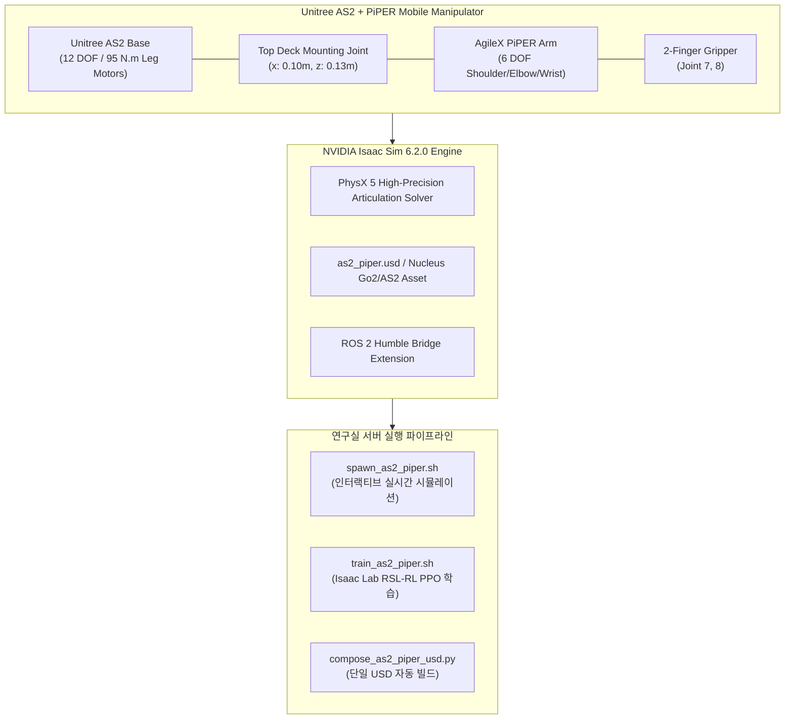

---
tags:
  - isaac-sim
  - isaac-lab
  - unitree-as2
  - agilex-piper
  - mobile-manipulator
  - cgv-lab
aliases:
  - Unitree AS2 PiPER Guide
  - Isaac Sim 6.2.0 AS2 Guide
---

# NVIDIA Isaac Sim 6.2.0 & Isaac Lab 가이드: Unitree AS2 + AgileX PiPER

> [!summary]
> 본 문서는 Computer Graphics and Vision Lab (CGV)의 연구실 서버 환경에서 최신 **NVIDIA Isaac Sim 6.2.0** 및 **Isaac Lab**을 기반으로 **Unitree AS2 산업용 4족 보행 로봇 + AgileX PiPER 6자유도 로봇 암(Mobile Manipulator)**을 시뮬레이션 및 강화학습(RL)으로 운용하기 위한 종합 기술 가이드입니다.

---

## 1. 하드웨어 플랫폼: Unitree AS2 & AgileX PiPER

* **사족보행 베이스 로봇**: **Unitree AS2 (유니트리 AS2)**
  - 국내 공급사: (주)로아스 (ROAS)
  - 본체 중량: 약 18.5 kg (산업용 고강도 설계)
  - 피크 관절 토크: **95 N·m** (고하중 로봇 암을 탑재하고도 역동적인 주행 가능)
  - 최고 속도: 5.0 m/s
* **탑재 로봇 암**: **AgileX PiPER (파이퍼)**
  - 자유도: 6자유도 암 + 2-Finger 전동 그리퍼
  - 마운트 위치: Unitree AS2 상단 데크 (`x: 0.10 m, z: 0.13 m`)
  - 통신 방식: CAN 통신 (1 Mbps) 및 ROS 2 Humble 브릿지

---

## 2. Isaac Sim 6.2.0 시스템 구조



---

## 3. 연구실 서버(Lab Server) 빠른 실행 절차

태블릿에서 푸시된 **`As2`** 브랜치를 연구실 서버에서 내려받아 즉시 구동할 수 있습니다.

### Step 1: 브랜치 풀 및 서브모듈 동기화
```bash
# 1. As2 브랜치 체크아웃 및 최신 코드 풀
git checkout As2
git pull origin As2

# 2. AgileX 공식 PiPER USD/URDF 서브모듈 동기화
git submodule update --init --recursive
```

### Step 2: Isaac Sim 6.2.0에서 AS2 + PiPER 시뮬레이션 구동
```bash
# 기본 AS2 + PiPER 복합 로봇 시뮬레이션 실행 (GUI)
./spawn_as2_piper.sh

# ROS 2 Bridge 연동 모드 (/tf, /joint_states)
./spawn_as2_piper.sh --enable_ros2

# 단독 PiPER 로봇 암만 확인
./spawn_as2_piper.sh --standalone_arm

# 단독 Unitree AS2 사족보행 로봇만 확인
./spawn_as2_piper.sh --standalone_as2
```

### Step 3: Isaac Lab 모바일 매니퓰레이션 강화학습 (RL)
```bash
# 평지 보행 및 암 자세 제어 RSL-RL 학습 시작 (Headless 모드)
./train_as2_piper.sh

# 환경 수 변경 및 GUI 모니터링
./isaaclab.sh -p scripts/reinforcement_learning/rsl_rl/train.py \
    --task Isaac-Velocity-Flat-Unitree-AS2-Piper-v0 \
    --num_envs 64
```

---

## 4. 모델 파일 및 설정 파일 요약

| 구분 | 파일 경로 | 설명 |
| :--- | :--- | :--- |
| **Articulation 설정** | [`source/isaaclab_assets/isaaclab_assets/robots/as2_piper.py`](file:///sdcard/Documents/github/isaac-go2-ros2/source/isaaclab_assets/isaaclab_assets/robots/as2_piper.py) | `AS2_PIPER_CFG`, `UNITREE_AS2_CFG`, `PIPER_ARM_CFG` |
| **URDF / Xacro** | [`robot_arms/piper/descriptions/as2_piper.urdf`](file:///sdcard/Documents/github/isaac-go2-ros2/robot_arms/piper/descriptions/as2_piper.urdf) | AS2 본체 + PiPER 암 통합 기구학 정의 |
| **실행 스크립트** | [`spawn_as2_piper.sh`](file:///sdcard/Documents/github/isaac-go2-ros2/spawn_as2_piper.sh) | Isaac Sim 6.2.0 원클릭 인터랙티브 스폰 스크립트 |
| **RL 학습 스크립트** | [`train_as2_piper.sh`](file:///sdcard/Documents/github/isaac-go2-ros2/train_as2_piper.sh) | `Isaac-Velocity-Flat-Unitree-AS2-Piper-v0` 학습 스크립트 |
| **USD 합성 도구** | [`scripts/tools/compose_as2_piper_usd.py`](file:///sdcard/Documents/github/isaac-go2-ros2/scripts/tools/compose_as2_piper_usd.py) | 복합 USD 단일 파일 빌드 도구 |
