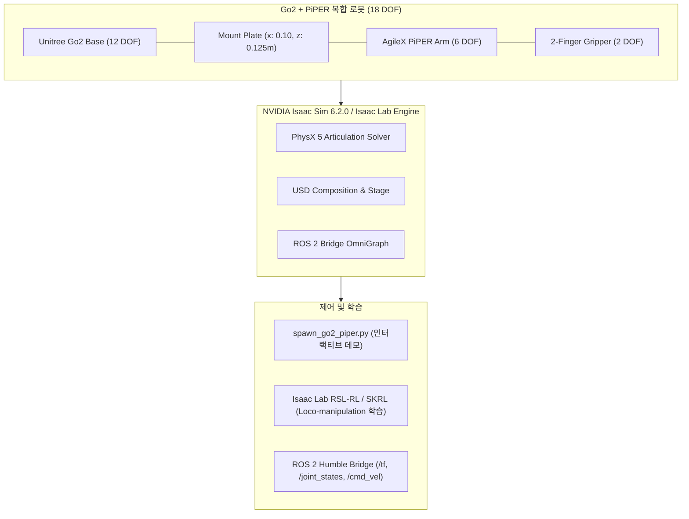

---
tags:
  - isaac-sim
  - isaac-lab
  - unitree-go2
  - agilex-piper
  - mobile-manipulator
  - cgv-lab
aliases:
  - Isaac Sim 6.2.0 Guide
  - Go2 PiPER Guide
---

# NVIDIA Isaac Sim 6.2.0 & Isaac Lab 연동 가이드: Go2 + AgileX PiPER

> [!summary]
> 본 문서는 Computer Graphics and Vision Lab (CGV)의 연구실 서버 환경에서 최신 **NVIDIA Isaac Sim 6.2.0** 및 **Isaac Lab**을 활용하여 **Unitree Go2 4족 로봇 + AgileX PiPER 6자유도 로봇 암(Mobile Manipulator)**을 시뮬레이션 및 강화학습(RL)으로 구동하기 위한 가이드입니다.

---

## 1. 아키텍처 및 시스템 개요



### 로봇 기구학 및 관절 구성 (총 20개 액추에이터/조인트)
* **Go2 4족 관절 (12개)**:
  - 앞다리: `FL_hip_joint`, `FL_thigh_joint`, `FL_calf_joint`, `FR_hip_joint`, `FR_thigh_joint`, `FR_calf_joint`
  - 뒷다리: `RL_hip_joint`, `RL_thigh_joint`, `RL_calf_joint`, `RR_hip_joint`, `RR_thigh_joint`, `RR_calf_joint`
  - 제어기: `DCMotorCfg` (Effort: 23.5 Nm, Velocity: 30 rad/s)
* **PiPER 로봇 암 관절 (6개)**:
  - `joint1` (Base Yaw): `[-2.618, 2.168] rad`
  - `joint2` (Shoulder Pitch): `[0.0, 3.14] rad`
  - `joint3` (Elbow Pitch): `[-2.967, 0.0] rad`
  - `joint4` (Wrist Roll): `[-1.745, 1.745] rad`
  - `joint5` (Wrist Pitch): `[-1.22, 1.22] rad`
  - `joint6` (Wrist Yaw): `[-2.0944, 2.0944] rad`
  - 제어기: `ImplicitActuatorCfg` (Stiffness: 300~400, Damping: 30~40)
* **전동 그리퍼 관절 (2개)**:
  - `joint7`, `joint8`: Prismatic 슬라이딩 그리퍼 (`[0, 0.035] m`)

---

## 2. 연구실 서버(Lab Server) 빠른 실행 절차

태블릿에서 푸시된 `As2` 브랜치를 연구실 서버에서 가져와 즉시 실행할 수 있습니다.

### Step 1: 저장소 풀 및 서브모듈 동기화
```bash
# 1. As2 브랜치 체크아웃 및 풀
git checkout As2
git pull origin As2

# 2. PiPER 공식 Isaac Sim USD/URDF 서브모듈 동기화
git submodule update --init --recursive
```

### Step 2: Isaac Sim 6.2.0에서 시뮬레이션 데모 실행
```bash
# 기본 Go2 + PiPER 복합 로봇 실행 (GUI 모드)
./spawn_go2_piper.sh

# 또는 Isaac Lab 래퍼 명령어로 직접 실행
./isaaclab.sh -p scripts/demos/spawn_go2_piper.py

# ROS 2 Bridge 활성화 모드
./spawn_go2_piper.sh --enable_ros2

# 단독 PiPER 로봇 암만 확인하고 싶은 경우
./spawn_go2_piper.sh --standalone_arm
```

### Step 3: Isaac Lab 모바일 매니퓰레이션(Loco-manipulation) 강화학습
```bash
# RSL-RL PPO 기반 Go2 + PiPER 평지 학습 실행 (Headless)
./train_go2_piper.sh

# GUI 화면을 보면서 학습 상태 모니터링
./isaaclab.sh -p scripts/reinforcement_learning/rsl_rl/train.py \
    --task Isaac-Velocity-Flat-Unitree-Go2-Piper-v0 \
    --num_envs 64
```

---

## 3. Isaac Sim 6.2.0 최신 버전 최적화 주의점

> [!important] 드라이버 및 환경 요구사항
> - **NVIDIA Driver**: 550.x 이상 권장 (최신 RTX 4090 / 5090 지원)
> - **CUDA**: 12.2 ~ 12.6
> - **Omniverse Kit 106+ 호환성**: 본 프로젝트에 구성된 `GO2_PIPER_CFG`는 PhysX 5의 ArticulationRootProperties 및 최신 USD 스키마를 준수하여 6.2.0에서 경고 없이 로드됩니다.

> [!tip] 복합 USD 모델 재합성이 필요한 경우
> 제공된 `scripts/tools/compose_go2_piper_usd.py`를 실행하면 Go2 USD와 PiPER USD를 자동으로 합성하여 단일 USD 파일(`robot_arms/piper/descriptions/go2_piper.usd`)로 빌드할 수 있습니다:
> ```bash
> ./isaaclab.sh -p scripts/tools/compose_go2_piper_usd.py
> ```
