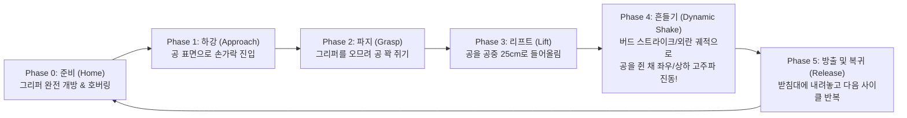

# Bird Strike (BS) Experiment & Pre-Flight Verification Package
**Computer Graphics and Vision Lab (CGV)**  
*담당: 민석 (Minseok) | 타겟: IEEE RA-L / IROS 2026*

> [!IMPORTANT]
> **실험 목적 및 배경 (Executive Summary)**
> 본 디렉터리는 **버드 스트라이크(Bird Strike, BS)** 및 급격한 카메라/타겟 외란 상황에서 비전 추적 알고리즘의 강건성(Robustness)을 검증하기 위한 **로봇팔 기반 정밀 외란 재현성 실험 패키지**입니다.
> 
> 사람이 손으로 흔드는 수동 방식(Manual Shaking)의 고질적 문제인 **"인간 편향(Human Bias) 및 재현성 결여"**를 완전히 제거하고, **AgileX PiPER 6-DOF 로봇암을 이용해 100% 동일한 가속도와 주파수를 갖는 결정론적 외란(Deterministic Disturbance)**을 인가합니다.

---

## 1. 디렉터리 구성

```
experiments/bird_strike/
├── README.md                           # 실험 개요 및 가이드 (본 문서)
├── run_sim_check.sh                    # Isaac Sim 시뮬레이션 원클릭 실행 런처
├── sim_piper_ball_pick_and_move.py     # 공 파지 및 다이내믹 쉐이크 시뮬레이터 검증 코드
└── trajectories/                       # 실물 PiPER 드래그 티칭 궤적 저장소 (.csv, .json)
    └── .gitkeep
```

---

## 2. 5단계 동작 시퀀스 (5-Phase Pick & Shake Sequence)



* **Phase 0~1 (준비 및 접근)**: 그리퍼 폭 0.07m 개방 상태로 공 상단에 접근.
* **Phase 2 (파지)**: 직경 4.4cm(반지름 0.022m) 오렌지색 공을 대칭 스트로크(0.013m)로 단단히 쥠.
* **Phase 3 (리프트)**: 어깨/팔꿈치 관절을 이용해 공을 공중으로 상승.
* **Phase 4 (외란 모션)**: 4.5초간 베이스 요 스윙($\pm 20^\circ$), 손목 롤 진동($\pm 23^\circ$), 피치 떨림을 가해 **카메라 지터 및 순간 충격 외란 모션** 생성.
* **Phase 5 (해제 및 복귀)**: 받침대에 정확히 공을 내려놓고 그리퍼를 열어 다음 사이클 준비.

---

## 3. 실행 방법 (Usage)

### ① Isaac Sim 시뮬레이션 사전 검증 (Pre-Flight Run)
```bash
# 기본 실행 (단독 PiPER 로봇암)
./experiments/bird_strike/run_sim_check.sh

# 또는 저장소 루트 런처 사용:
./launchers/run_piper_ball_demo.sh

# Unitree AS2 사족보행 로봇 상판 장착 모드:
./experiments/bird_strike/run_sim_check.sh --as2
```

### ② 공 크기 및 물리 파라미터 변경
```bash
./experiments/bird_strike/run_sim_check.sh --ball_radius 0.025 --ball_mass 0.05
```

---

## 4. 실물 로봇 연동 및 티칭 가이드 (Sim-to-Real Roadmap)

1. **실물 PiPER 드래그 티칭(Drag Teaching)**:
   * 로봇팔 전원을 켜고 티칭 모드를 활성화한 뒤, 손으로 공을 쥐고 흔드는 궤적을 3종(`mild_jitter`, `bird_strike_hard`, `occlusion_sweep`) 녹화.
   * 녹화된 관절 궤적을 `experiments/bird_strike/trajectories/` 폴더에 `.csv`로 저장.
2. **카메라 추적 알고리즘 벤치마크**:
   * 저장된 궤적을 50회 연속 재생하며, 추적 알고리즘의 **(1) 타겟 유실률(Tracking Failure Rate)** 및 **(2) 충격 후 복구 시간(Recovery Time, ms)**을 정량 측정하여 논문 표로 작성.

---
*Computer Graphics and Vision Lab (CGV) - Autonomous Robotics & Vision Team*
