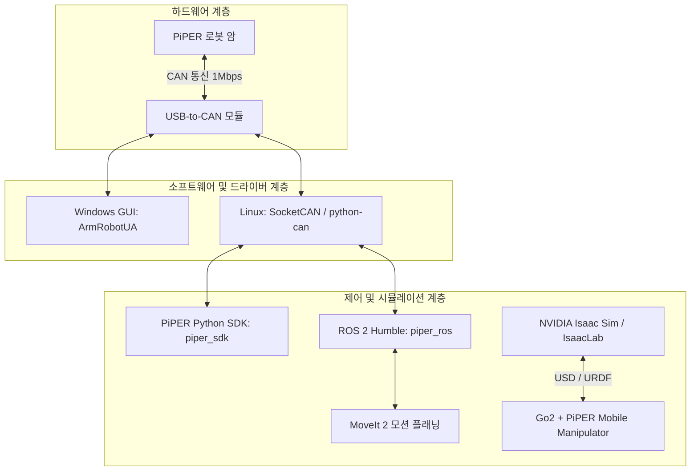

---
tags:
  - robotics
  - agilex
  - piper
  - robot-arm
  - isaac-sim
  - ros2
  - cgv-lab
aliases:
  - PiPER Guide
  - AgileX PiPER Robot Arm
---

# AgileX PiPER 로봇 암 (Robotic Arm) 연동 가이드

> [!summary]
> 본 문서는 로아스(ROAS) 기술지원팀을 통해 도입된 **AgileX PiPER(파이퍼) 경량 로봇 암**을 `isaac-go2-ros2` 프로젝트(브랜치: `As2`) 및 Unitree Go2 4족 보행 로봇과 통합 운용하기 위한 종합 기술 가이드입니다.

---

## 1. 하드웨어 및 기술지원 자료 개요

* **제조사 / 공급사**: AgileX Robotics / (주)로아스 (ROAS) 기술지원팀
* **로봇 모델**: **AgileX PiPER** (6자유도 경량 매니퓰레이터 + 전동 그리퍼)
* **주요 용도**: Unitree Go2 상단 마운트를 통한 모바일 매니퓰레이션(Mobile Manipulation), Isaac Sim 시뮬레이션, ROS 2 기반 원격 티칭 및 자율 작업

### 공식 리소스 링크
- **AgileX 공식 GitHub**: [https://github.com/agilexrobotics](https://github.com/agilexrobotics)
- **PiPER Python SDK**: [https://github.com/agilexrobotics/piper_sdk](https://github.com/agilexrobotics/piper_sdk)
- **PiPER ROS / ROS 2**: [https://github.com/agilexrobotics/piper_ros](https://github.com/agilexrobotics/piper_ros)
- **PiPER Isaac Sim (USD/URDF)**: [https://github.com/agilexrobotics/piper_isaac_sim](https://github.com/agilexrobotics/piper_isaac_sim)

---

## 2. 소프트웨어 스택 분석



### 2.1. Windows 전용 유틸리티 (`ArmRobotUA`)
- **버전**: `ArmRobotUA_V1.6.3.260828_release 1.zip`
- **역할**:
  1. 로봇 암 수령 직후 펌웨어 버전 확인 (`GetPiperFirmwareVersion`)
  2. 관절별 영점(Zero-point) 보정 및 캘리브레이션
  3. 실시간 조그 제어 및 안전 리밋 설정

### 2.2. Python SDK (`piper_sdk`)
- SocketCAN 기반 저수준(Low-level) 고속 제어 (최대 200Hz 피드백 루프).
- `pip install python-can piper_sdk`로 간편하게 설치 가능.

> [!important] 펌웨어 버전별 인터페이스 분기
> - **구버전 / 기본**: `C_PiperInterface("can0")`
> - **최신 펌웨어 (V1.8-8 이상)**: `C_PiperInterface_V3("can0")` 사용 필수

### 2.3. ROS 2 인터페이스 (`piper_ros` - `humble` 브랜치)
- 메일 본문에는 구 SDK 자료로 표기되어 있으나, AgileX 공식 GitHub의 `humble` 브랜치에 ROS 2 표준 패키지가 구축되어 있습니다:
  - `piper_description`: 로봇 암 URDF/Xacro 및 3D 메시 모델
  - `piper_msgs`: 관절 상태, 엔드이펙터 포즈 피드백/명령 메시지
  - `piper_humble`: ROS 2 전용 CAN 드라이버 노드 (`piper_ctrl_single_node`)
  - `piper_moveit`: MoveIt 2 기반 경로 계획 및 장애물 회피

### 2.4. Isaac Sim 시뮬레이션 자산 (`piper_isaac_sim`)
- NVIDIA Isaac Sim 환경에서 사용할 수 있는 전용 USD 및 URDF 자산 포함 (`piper_description`, `piper_h_description`, `realsense2_description`).
- `isaac-go2-ros2`의 IsaacLab 환경에 직접 임포트하여 강화학습 및 로코매니퓰레이션(Loco-manipulation) 학습 가능.

---

## 3. CAN 통신 설정 및 실행 방법 (Linux 환경)

### 3.1. USB-to-CAN 인터페이스 활성화
CAN 통신 기본 전송 속도는 **1,000,000 bps (1 Mbps)** 입니다.

```bash
# 단일 CAN 모듈 활성화 (can0)
sudo ip link set can0 type can bitrate 1000000
sudo ip link set up can0

# 또는 패키지 내 스크립트 실행
bash can_activate.sh can0 1000000
```

### 3.2. Python SDK 테스트 예제

```python
import time
from piper_sdk import C_PiperInterface, LogLevel

# CAN 인터페이스 인스턴스 생성 (1Mbps)
piper = C_PiperInterface(can_name="can0", dh_is_offset=1)
piper.ConnectPort()

# 로봇 상태 및 관절각 모니터링 (200Hz)
try:
    while True:
        joint_state = piper.GetArmJointMsgs()
        print(f"Joint Angles: {joint_state}")
        time.sleep(0.005)
except KeyboardInterrupt:
    print("수신 종료")
```

---

## 4. 빠른 환경 구축 및 Isaac Sim 6.2.0 실행

### 4.1. Isaac Sim 6.2.0 데모 즉시 실행
```bash
# Unitree AS2 + AgileX PiPER 모바일 매니퓰레이터 시뮬레이션 실행
./spawn_as2_piper.sh

# 단독 PiPER 로봇 암 실행
./spawn_as2_piper.sh --standalone_arm

# 단독 Unitree AS2 사족보행 로봇 실행
./spawn_as2_piper.sh --standalone_as2
```

### 4.2. Isaac Lab 강화학습 (RL Loco-manipulation)
```bash
# RSL-RL PPO 기반 AS2 + PiPER 강화학습 실행
./train_as2_piper.sh
```

자세한 서버 배포 및 최신 Isaac Sim 6.2.0 설정은 [docs/isaac_sim_6_2_as2_piper_guide.md](../../docs/isaac_sim_6_2_as2_piper_guide.md) 문서를 참고하십시오.

---

## 5. CGV Lab 연구 로드맵: Go2 + PiPER 통합

1. **Phase 1: 단독 하드웨어 검증**: Windows `ArmRobotUA` 및 `piper_sdk`를 통한 캘리브레이션 및 기본 모션 검증.
2. **Phase 2: ROS 2 기반 통합 제어**: ROS 2 Humble 환경에서 Go2 제어기(`unitree_ros2`)와 `piper_ros` 동시 구동.
3. **Phase 3: IsaacLab 복합 시뮬레이션**: Go2 4족 로봇 상단에 PiPER URDF/USD를 결합하여 모바일 매니퓰레이션 강화학습(Loco-manipulation RL) 환경 구축.
